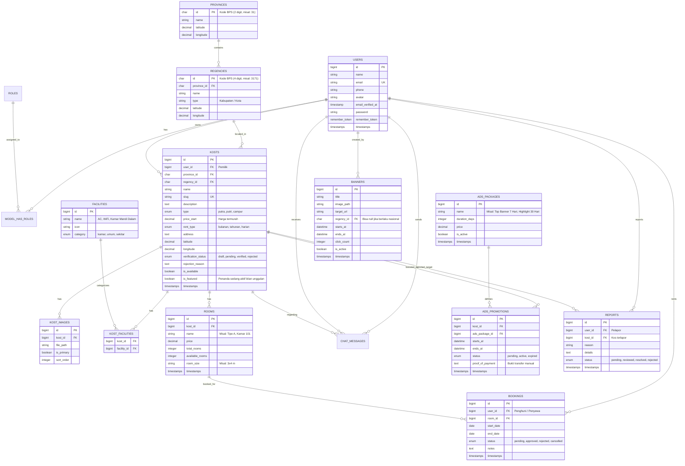

# Entity Relationship Diagram (ERD) - Seven Kost (MVP)

Dokumen ini mendefinisikan rancangan struktur database dan relasi antar entitas untuk platform Seven Kost (tahap MVP 1 Bulan).

## Diagram Mermaid

---

## Ringkasan 5 Peran (RBAC Spatie)

1. **`superadmin`**: Mengelola admin, mengatur tarif iklan unggulan, mengelola slot banner, jejak audit, dan seluruh akses sistem.
2. **`admin`**: Memverifikasi listing kos baru, mengelola moderasi dan laporan pelanggaran, serta mencatat status pembayaran paket unggulan.
3. **`pemilik`**: Membuat dan mengelola iklan kos, mengelola kamar, melihat dan merespons pengajuan sewa, membeli paket iklan unggulan.
4. **`penghuni`**: Menjelajahi kos, mengajukan sewa kos (booking), mengirim chat/kontak pemilik kos, mengelola profil penyewa.
5. **`pengunjung`**: Menjelajahi pencarian kos, filter berdasarkan wilayah & fasilitas, melihat detail kos tanpa login.

